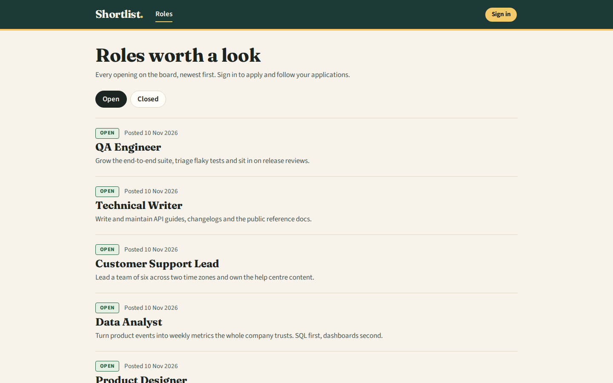
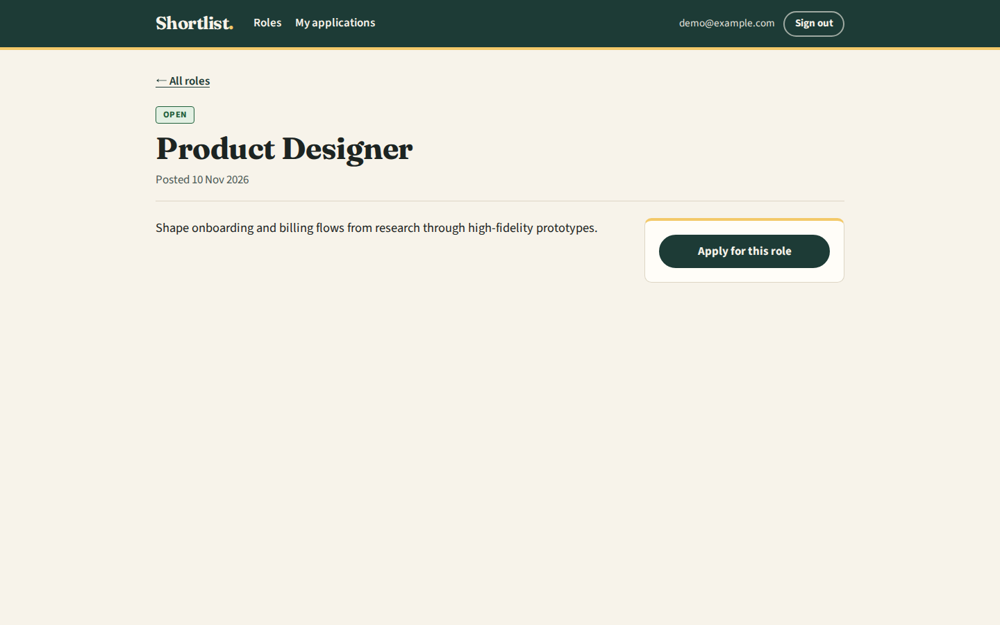
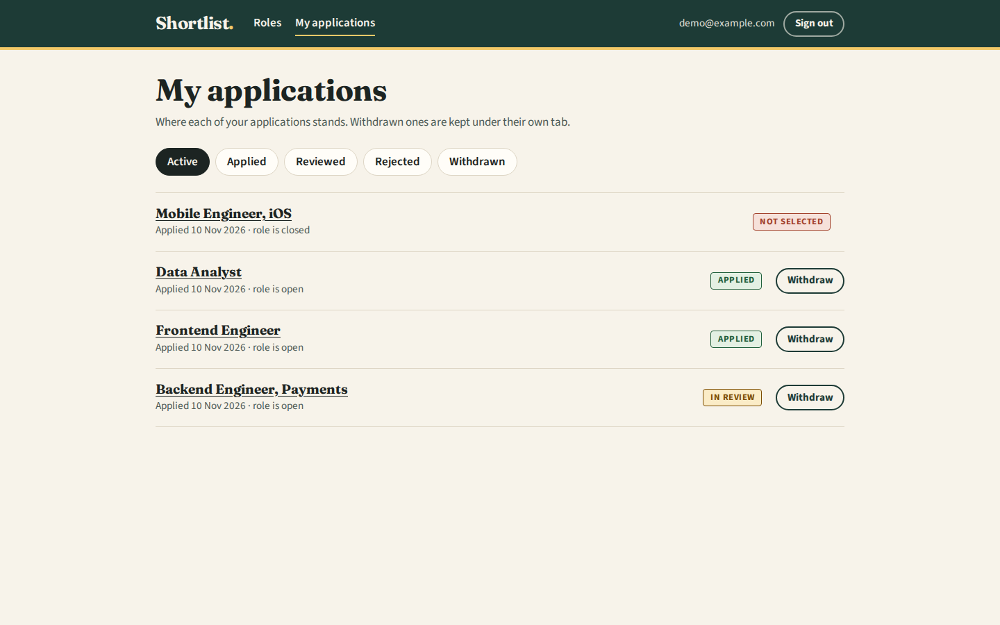
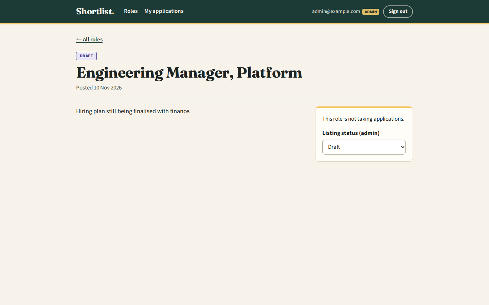
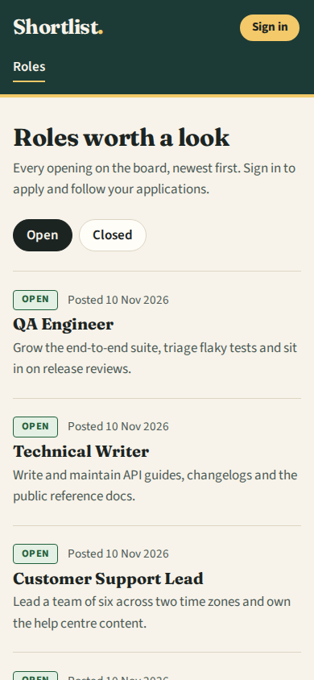
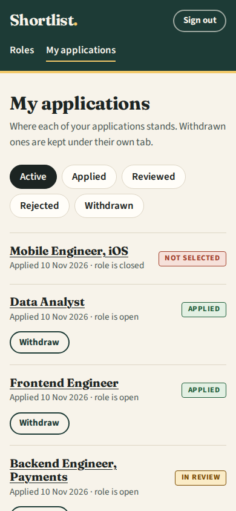
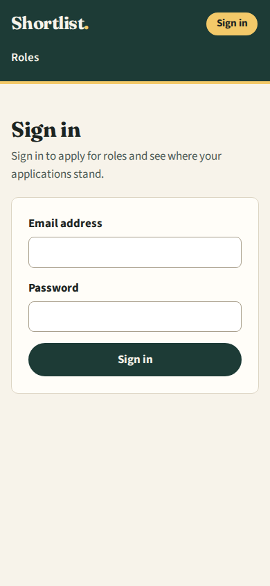
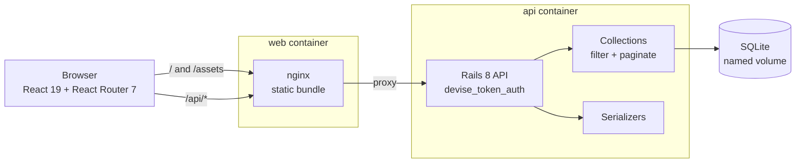

# Shortlist: a job board API with a React client

Shortlist is a small job board. A Rails API stores roles and applications, and a React client lets people browse roles, apply, and follow where each application stands. Admins can publish, close and unpublish roles and move applications through review.

The repository is called `rails-react-starter` because it began as a take-home exercise built from a Rails + React starter. It is not a reusable template. It is one complete app with its own data model, authorization rules and UI.



| Role detail (signed in) | My applications | Admin view of a draft |
| --- | --- | --- |
|  |  |  |

| Roles on a phone | Applications on a phone | Sign in |
| --- | --- | --- |
|  |  |  |

All screenshots use the seeded demo data. Every person and company in them is made up.

## What it does

- **Roles** are `open`, `closed` or `draft`. Anyone can browse open and closed roles. Drafts are visible only to admins.
- **Applying** needs an account and works only on open roles, once per role.
- **Applications** are `applied`, `reviewed`, `rejected` or `withdrawn`. Applicants see their own applications only and can withdraw them while they are applied or in review. Only admins can set `reviewed` or `rejected`.
- **Admins** (users with `admin = true`) can change a role's status from its page. They can also set any application's status through the API. The client has no screen for reviewing applicants yet.

| Action | Visitor | Applicant | Admin |
| --- | --- | --- | --- |
| List and open open/closed roles | yes | yes | yes |
| See draft roles | no | no | yes |
| Change a role's status | 401 | 403 | yes |
| Apply to an open role | 401 | yes, once | yes, once |
| See or withdraw an application | 401 | own only | own only |
| Set an application to reviewed/rejected | 401 | 403 | any application |

## Run it with Docker Compose

You need Docker with Compose v2.

```sh
cp .env.example .env    # optional; the defaults work
docker compose up --build
```

Open http://localhost:8080 (or the port set in `WEB_PORT`). The first start creates the SQLite database and loads the demo data:

| Account | Password | Role |
| --- | --- | --- |
| `demo@example.com` | `shortlist-demo` | applicant with applications in every status |
| `admin@example.com` | `shortlist-demo` | admin |

Change the password with `SEED_PASSWORD` before the first start, or set `SEED_DEMO_DATA=false` to start empty. The API container makes a `SECRET_KEY_BASE` and stores it in its volume unless you set one. `docker compose down -v` deletes the database.

Both images run as non-root users. The API runs as `rails` (uid 1000) and nginx runs as `nginx`.

## Run it without Docker

You need Ruby 3.4.12 (see `.ruby-version`) and Node 22 (see `client/.nvmrc`).

```sh
bundle install
bin/rails db:prepare                  # creates, migrates and seeds a new database
bin/rails server                      # API on http://localhost:3000
```

In a second terminal:

```sh
cd client
npm ci
npm run dev                           # http://localhost:5173, proxies /api to :3000
```

`API_PROXY_TARGET` in `client/.env` (see `client/.env.example`) changes where the dev server sends `/api`.

## Tests and lint

```sh
bundle exec rspec            # 92 examples: models, request specs, pagination, seeds
bundle exec rubocop          # rubocop-rails-omakase

cd client
npm test                     # 39 Vitest tests: API client, auth flow, pages
npm run lint
npm run build
```

## How it fits together



Because nginx serves the bundle and proxies `/api`, the browser talks to a single origin. In development, Vite's proxy does the same job, so CORS only matters if you host the client somewhere else (`CORS_ORIGINS`).

### API

| Method and path | Auth | Notes |
| --- | --- | --- |
| `POST /api/auth/sign_in` | none | returns the user and the token headers |
| `GET /api/auth/validate_token` | token | used by the client to restore a session after reload |
| `DELETE /api/auth/sign_out` | token | |
| `GET /api/jobs` | optional | `filter` = `open` (default), `closed`, `draft` (admins); `page`, `per_page` |
| `GET /api/jobs/:slug` | optional | includes `application_status` for the signed-in user |
| `PUT /api/jobs/:slug` | admin | `{ "status": "closed" }` |
| `GET /api/job_applications` | token | own applications; `filter` by status, default hides withdrawn |
| `POST /api/job_applications` | token | `{ "job_id": 5 }` |
| `PATCH /api/job_applications/:id` | token | applicants: `withdrawn` only; admins: any status |
| `DELETE /api/job_applications/:id` | token | withdraws (the row is kept) |
| `GET /up` | none | health check |

These examples were captured from the Compose stack with the demo data. Tokens are redacted.

```http
GET /api/jobs?per_page=2

200 OK
{"jobs":[{"id":8,"title":"QA Engineer","description":"Grow the end-to-end suite, triage flaky tests and sit in on release reviews.","status":"open","slug":"qa-engineer","created_at":"2026-11-10T12:07:52.126Z","application_status":null},
         {"id":7,"title":"Technical Writer", ...}],
 "page_info":{"page":1,"pages":4,"per_page":2,"count":8,"prev":null,"next":2}}
```

```http
POST /api/auth/sign_in
{"email":"demo@example.com","password":"shortlist-demo"}

200 OK
access-token: [REDACTED]
client: [REDACTED]
uid: demo@example.com
expiry: 1795522076
token-type: Bearer

{"data":{"email":"demo@example.com","provider":"email","uid":"demo@example.com","id":2,"allow_password_change":false,"name":"Dana Demo","nickname":null,"image":null,"admin":false}}
```

Send `access-token`, `client` and `uid` back on later requests:

```http
GET /api/job_applications?per_page=2

200 OK
{"job_applications":[{"id":5,"status":"rejected","job_id":9,"created_at":"2026-11-10T12:07:52.183Z",
                      "job":{"id":9,"title":"Mobile Engineer, iOS","status":"closed","slug":"mobile-engineer-ios", ...}},
                     {"id":3,"status":"applied","job_id":5, ...}],
 "page_info":{"page":1,"pages":2,"per_page":2,"count":4,"prev":null,"next":2}}
```

These are the errors an applicant runs into:

```http
PUT /api/jobs/frontend-engineer        {"status":"closed"}      -> 403 {"message":"Only admins can do that"}
POST /api/job_applications             {"job_id":10}            -> 422 {"message":["You can only apply to an open job"]}
PATCH /api/job_applications/2          {"status":"reviewed"}    -> 403 {"message":"Only admins can mark an application reviewed"}
GET /api/jobs/engineering-manager-platform  (a draft, anonymous) -> 404 {"message":"Couldn't find Job"}
GET /api/jobs?page=abc&per_page=100000                           -> 200, "page_info":{"page":1,...,"per_page":50,...}
```

## Design notes

- **Token handling lives in one place.** `client/src/api/client.js` wraps `fetch`. It keeps the five devise_token_auth headers (`access-token`, `client`, `uid`, `expiry`, `token-type`) in localStorage and sends them on every request. It replaces them when the server sends new ones, discards them once `expiry` has passed, and clears them on any 401. `AuthProvider` checks a stored token with `validate_token` on load, so a page reload keeps you signed in. Because the token sits in localStorage, any XSS on the page could read it. The client renders no HTML from the API, so React escapes all of it.
- **Collections** (`app/collection`) narrow the controller's base relation by status and paginate it with pagy. A missing or invalid `per_page` falls back to 5, `per_page` is capped at 50, a bad `page` means page 1, and a page past the end returns the last page.
- **Serializers only show your own data.** The job JSON carries `application_status` for the signed-in user instead of embedding the job's applications. Older versions leaked other applicants' user ids this way.
- **Slugs** are built from the title before validation and backed by a unique index, so `C++ Developer` and `C Developer` cannot share a URL.
- **Sessions:** API-only Rails 8 has no session, but Devise writes to one during sign-in. A cookie store is mounted for that write and skipped on every request, so no session cookie is ever sent.
- **No encrypted credentials.** The original `config/credentials.yml.enc` had no matching key, so nothing reads credentials. The file is left out of git. Configuration comes from environment variables.

## Configuration

| Variable | Used by | Default |
| --- | --- | --- |
| `SECRET_KEY_BASE` | API (production) | generated into the storage volume by the entrypoint |
| `SEED_DEMO_DATA` | API container | `true` in compose |
| `SEED_PASSWORD` | `db/seeds.rb` | `shortlist-demo` |
| `DATABASE_PATH` | API (production) | `storage/production.sqlite3` |
| `CORS_ORIGINS` | API | `http://localhost:5173` |
| `FORCE_SSL` | API (production) | off |
| `WEB_PORT` | compose | `8080` |
| `API_PROXY_TARGET` | Vite dev server | `http://localhost:3000` |
| `VITE_API_URL` | client build | `/api` |

## Known limitations

- There is no sign-up screen, although the API accepts `POST /api/auth`. Admins have no UI for reviewing applicants; the API supports it.
- Password reset emails are not configured.
- SQLite keeps the app to a single API container, which is fine for a demo but not for scaling out.

## License

MIT, see [LICENSE](LICENSE).
